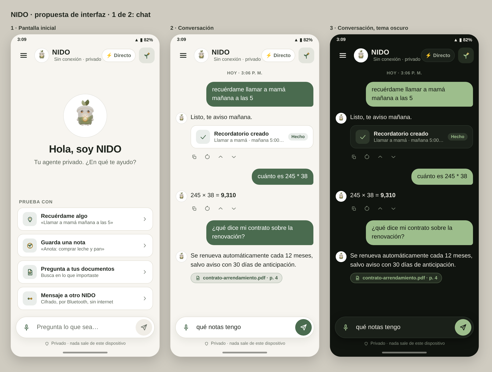

> **Idioma:** [English](README.md) · Español

<p align="center">
  
</p>

<h1 align="center">NIDO</h1>

<p align="center"><b>Tu agente, tu mundo.</b><br>
Un asistente de IA privado que funciona por completo en tu teléfono Android.</p>

<p align="center">
  <a href="https://github.com/Nido007-cmyk/Nido/releases"></a>
  <a href="https://github.com/Nido007-cmyk/Nido/actions/workflows/ci.yml"></a>
  <a href="LICENSE"></a>
  
</p>

<p align="center">
  
</p>
<p align="center"><sub>Maquetas de diseño del chat en v0.1.1-alpha. Las pantallas publicadas pueden diferir en detalles.</sub></p>

## Qué es NIDO

NIDO es un asistente personal que piensa en tu teléfono, no en el servidor
de otra persona. El modelo de lenguaje, tu memoria y tus documentos se quedan
en el dispositivo, cifrados. No hay cuentas, ni nube, ni analíticas.

> **Software en alfa.** NIDO es una alfa temprana para pruebas y comentarios.
> No ha pasado una auditoría de seguridad independiente. Todavía no confíes
> en él para secretos importantes. Consulta las
> [limitaciones conocidas](docs/ALPHA_RELEASE_NOTES.md#known-limitations).

## Qué hace hoy

- **Conversa sin conexión** con un modelo de lenguaje pequeño que corre en
  el teléfono (llama.cpp mediante `llama.rn`).
- **Recuerda por ti**: datos, notas y recordatorios, guardados en una base
  cifrada con SQLCipher. La clave vive en el Keystore de Android. Los
  cumpleaños que le cuentas tienen recordatorio cada año. Si lo activas,
  recibes un resumen diario a las 8:00 (viene apagado). Puedes preguntar en
  español, inglés o portugués por algo que guardaste en otra de las tres, y
  «olvida mi color favorito» borra ese recuerdo después de que lo confirmes.
- **Actúa cuando se lo pides**: recordatorios (una vez, o cada día, semana,
  mes o año), cuentas atrás, notas, eventos de calendario, conversión de
  unidades, cálculos, abrir enlaces. Todo lo que tiene efecto fuera de la
  app pide antes tu confirmación. El texto que pegas o compartes desde otra
  app nunca se toma como una orden, y si un mensaje trae más de una petición,
  NIDO muestra la orden como un botón y espera a que lo toques.
- **Responde con tus documentos**: importa archivos `.txt`, `.md`, `.csv`,
  `.json` o `.pdf`, y también imágenes y PDF escaneados, cuyo texto NIDO
  lee en el propio teléfono en español, inglés o portugués, y NIDO los
  indexa en el teléfono.
- **Sabe cosas sin internet**: una base de conocimiento integrada y un
  paquete opcional de Wikipedia (unos 50.000 artículos) y nueve paquetes
  de guías escritos por NIDO (Esencial, Emergencias por país, Niños y
  bebés, Crisis y salud mental, Vivir sin servicios, Hogar seguro,
  Desastres, Campo y animales, Carretera y viaje), con números de
  emergencia verificados de 69 países. Esencial y Emergencias por país
  van dentro de la app desde la 0.1.95; los otros siete son descargas
  opcionales. Con la búsqueda
  multilingüe activada puedes preguntar en español, portugués o inglés, y las
  respuestas muestran los artículos de donde salen, con una línea que cuenta
  qué frases salen de ellos y cuáles del modelo sin fuente; si nada de la base
  encaja de verdad, no se muestra ninguna fuente.
- **Añade packs firmados desde un archivo** (0.1.80): Ajustes → Base de
  conocimiento → «Añadir un pack desde un archivo» añade un paquete de
  conocimiento que tengas como archivo, por ejemplo uno publicado por
  SALVORA PACKS. Antes de copiar nada, la app comprueba su firma Ed25519
  contra las llaves que lleva dentro (solo la de NIDO y la de SALVORA
  PACKS, ninguna de terceros), coteja la huella del archivo con su
  manifiesto firmado y rechaza cualquier pack que no pase. Cada pack
  añadido muestra quién lo firmó y se puede eliminar desde la misma
  pantalla.
- **Lee las guías como documentos** (0.1.81): la biblioteca de guías
  abre cualquier guía de los packs instalados en el dispositivo y la
  muestra entera, de principio a fin, como un documento. Leer no carga
  el modelo de lenguaje, así que funciona incluso en un teléfono que
  aún no ha descargado ningún modelo, y nunca usa la red. Una guía muy
  larga se muestra acortada, con un aviso que lo dice; la guía sigue
  guardada entera en su pack.
- **Vuelve a cargar sus modelos en aparatos con poca RAM** (0.1.82):
  la comprobación que corre antes de cargar un modelo cobraba a cada
  modelo unos 0,29 GB por unos resultados que el motor solo produce
  para una posición, así que en una tableta de unos 3,3 GB de RAM
  ningún modelo pasaba la comprobación, liberaras la memoria que
  liberaras. El cobro está corregido; la comprobación sigue
  negándose cuando la memoria escasea de verdad, por ejemplo con
  otras apps abiertas.
- **Más ligero en memoria: los modelos cargan de uno en uno y solo
  cuando hacen falta** (0.1.83): el modelo de chat y el de búsqueda
  arrancaban a la vez, cada uno comprobando la misma memoria libre
  como si estuviera solo; ahora arrancan uno tras otro, y si una
  carga se rechaza queda registrada con las cifras que vio la
  comprobación. Al abrir la app carga solo el modelo de búsqueda,
  así que las guías y la búsqueda funcionan desde el principio; el
  modelo de chat carga la primera vez que envías un mensaje y se
  descarga a los tres minutos sin actividad de chat. En aparatos
  pequeños los modelos también nacen con un lote menor (y el modelo
  Qwen3 con un contexto menor), la batería baja, el ahorro de
  energía o el aparato caliente bajan los hilos, y cuando Android
  avisa de presión crítica de memoria los modelos se descargan en
  vez de esperar a que el sistema cierre la app.
- **La comprobación de memoria cobra lo que la carga cuesta de
  verdad, y los rechazos se pueden leer en la app** (0.1.84):
  cambiar de modelo ya no cuenta la memoria del modelo saliente
  como ocupada en el lado de la comprobación que decide; la caché
  de contexto y el búfer de cómputo se cobran con la precisión y
  el tamaño de lote que la carga va a usar de verdad; y en
  aparatos con 4 GB de memoria o menos la comprobación prueba un
  contexto corto, por debajo del suelo habitual, antes de
  negarse. La pantalla Telemetría de ejecución lista ahora cada
  carga rechazada con las cifras que vio la comprobación, y el
  registro viaja en sus exportaciones JSON y CSV.
- **El peldaño de emergencia de la comprobación de memoria usa
  la memoria que está libre de verdad, y descargar con orden ya
  no cuenta como choque** (0.1.85): en aparatos con 4 GB de
  memoria o menos, el contexto corto de último recurso se cobra
  contra la memoria libre que Android reporta en ese momento,
  sin la marca de agua ni el margen que restan los peldaños
  normales; descargar un modelo con orden (inactividad, presión
  del sistema, cambio de modelo) ya no degrada el guardián de
  choques como si la app hubiera fallado; y un rechazo juzgado
  sin la lectura de memoria en vivo ahora lo dice en su
  registro de telemetría. Todos los peldaños normales conservan
  la cuenta estricta, y la reserva del sistema de 2 GB no
  cambia.
- **Las guías de un pack importado y verificado se responden
  tal como están escritas, y la insignia de cada modelo es el
  veredicto de la carga real** (0.1.86): un pack que entró por
  la puerta de importación firmada y se verificó se sirve
  ahora palabra por palabra desde el chat, sin cargar el
  modelo de lenguaje, con la misma regla que los packs
  integrados, así que preguntar por una de sus guías ya no
  manda la pregunta al modelo con la memoria más justa; la
  insignia de compatibilidad de cada modelo se juzga con la
  misma especificación y el mismo veredicto del planificador
  que la carga misma (en una tableta como la del dueño el
  modelo de 1.5B se muestra ahora en rojo, porque ni su plan
  de emergencia más barato cabe ahí); importar un pack pide
  su manifiesto firmado con un segundo selector en vez de
  negarse cuando la primera selección no lo trajo; y la
  biblioteca de guías se puede abrir desde Ajustes en el uso
  normal. Una sospecha de doble conteo en el guardián de
  choques se probó con una regresión y no existe; el guardián
  no cambia.
- **Funciona desde el primer segundo, sin red** (0.1.95): una
  instalación nueva lleva dentro del APK las guías de primeros
  auxilios y los números de emergencia comprobados de 69
  países, así que la entrada Emergencia del asistente muestra
  los números de tu país antes de descargar nada y sin modelo.
  El borrado de pánico destruye ahora la clave de la base
  antes que nada.
- **El modelo solo se carga cuando el turno lo necesita,
  y las cifras ya no desbordan el contexto** (0.1.94): una
  pregunta que cubre una guía o una respuesta fija ya no
  espera la carga del modelo, y se responde aunque el
  modelo no quepa en memoria. El presupuesto de contexto
  cuenta cada cifra como lo hace el tokenizador: una
  pregunta sobre una tabla con contexto de 2.048 tokens
  recibía una respuesta cortada a 143 tokens, y con 4.096
  el motor rechazaba el prompt; ahora las dos se
  responden enteras.
- **La puerta de salud y emergencia decide por
  significado** (0.1.93): una pregunta sin fuentes que
  la puerta no reconoce como salud o emergencia la
  responde el modelo de memoria, y la puerta era una
  lista de palabras. En 45 preguntas de salud y
  emergencia que nunca había visto, la lista reconoció
  4. Ahora se le suma un clasificador pequeño sobre el
  vector de búsqueda de la pregunta: con el modelo de
  búsqueda multilingüe las dos juntas reconocen 40 de
  45, con el inglés por defecto 26 de 45, y ninguna
  cerró ninguna de 50 preguntas corrientes. Un mensaje
  sobre querer morir o hacerse daño recibe siempre un
  texto fijo con líneas de apoyo, nunca un modelo. La
  lectura en voz alta ya no lee el razonamiento del
  modelo, y un pack renombrado ya no puede ocupar el
  sitio de uno del catálogo.
- **Las cuentas se piensan, y una respuesta cortada
  siempre lo dice** (0.1.92): en el Qwen3-0.6B, una
  pregunta que es una cuenta (dos o más cifras y un
  «cuántos» o «a qué hora») deja ahora que el modelo
  razone antes de responder, solo en ese turno; medido
  con el archivo real del modelo y el prompt de la
  propia app, las respuestas correctas pasaron de 16 de
  60 a 41 de 60, y si el razonamiento no deja respuesta
  el turno se responde directo, como antes. El hecho de
  «la respuesta se cortó» se lee ahora de la señal de
  parada del propio motor en vez de contar los trozos
  transmitidos, que contaba de menos y podía dejar sin
  su nota a una respuesta parada por el tope. Un modelo
  marcado «Demasiado pesado» que aún tiene una parte
  descargada lo dice y ofrece borrarla, y un modelo cuya
  comprobación falla ya no deja en blanco el estado de
  los demás.
- **La descarga asienta, el modelo pesado deja de
  ofrecerse y la última línea se lee entera** (0.1.91):
  una descarga reintentada tras un fallo asienta con ese
  solo reintento: la tarjeta ofrece «Seleccionar y
  usar», porque la comprobación de presencia reintenta
  una vez el cálculo de la huella cuando el propio
  cálculo tropieza (una discrepancia real nunca se
  reintenta hasta darla por buena) y la tarjeta dice el
  motivo cuando una descarga terminada no puede
  mostrarse como instalada; un modelo marcado
  «Demasiado pesado para este dispositivo» ya no ofrece
  botón de descarga ni de reintento, porque esa marca
  roja es el veredicto de la propia vía de carga; y el
  lector de guías, la biblioteca de guías, la práctica
  de RCP y la hoja de países de emergencia guardan
  ahora su borde inferior dentro del área segura, así
  la última línea de una guía larga ya no queda cortada
  por la mitad por la barra del sistema; y la nota de
  «quedó poco espacio» bajo la respuesta del modelo
  sale ahora solo cuando una generación consumió de
  verdad todo su presupuesto de tokens, no cuando al
  turno solo se le asignó menos que el valor por
  defecto.
- **El modelo vuelve a responder, y sus respuestas
  terminan** (0.1.90): una pregunta que ninguna guía cubre
  la genera el modelo cargado en lugar de rechazarla (el
  rechazo ahora solo guarda las preguntas de salud y
  emergencia sin evidencia); el presupuesto de contexto
  reduce su reserva de generación antes de rendirse, así
  un cuento corto ya no muere con un error técnico en una
  ventana de contexto pequeña; y la longitud de respuesta
  por defecto se duplica, así una explicación en cinco
  pasos o un correo breve sale entero en lugar de cerrarse
  antes de tiempo.
- **Si huele a gas, sale la guía de la fuga, y dos pantallas
  dejan de pisarse** (0.1.89): la versión anterior hizo
  correr la vía palabra por palabra, y en la tableta del
  dueño sirvió una guía palabra por palabra para la
  pregunta del gas, con el nombre del pack y sin modelo de
  por medio, pero era la vecina del monóxido en vez de la
  guía de la fuga: medido contra el pack real del dueño, el
  propio orden por palabras del pack pone el fragmento del
  monóxido primero cuando empatan en cobertura, y el texto
  de esa guía dice que su gas no se puede oler. La elección
  lee ahora el signo de la pregunta: cuando una pregunta
  dice que algo se huele, se ve o se oye, una guía que
  declara que su peligro no se huele, no se ve o no se oye
  pierde el empate contra una que no lo declara, en
  español, inglés y portugués, y cuando la primera lista
  corta solo trae a la vecina equivocada, la app mira la
  lista ancha antes de servir nada. La cabecera del lector
  de guías queda ahora por debajo de la barra de estado
  del sistema, sin pisar la hora ni los iconos de batería.
  Y las pestañas de la pantalla NIDO se reparten el ancho
  según su etiqueta, para que la palabra larga quede en
  una sola línea; en un teléfono estrecho la fila se
  desplaza en vez de partir la palabra.
- **Habla con otro NIDO por Bluetooth**: mensajes cifrados entre dos
  teléfonos emparejados, sin internet y sin servidor. Para emparejar pegas
  el código del otro teléfono (el texto de su QR); un contacto aparece como
  verificado solo después de comparar las huellas los dos, en persona o por
  llamada, y pulsar Verificar. Nuevo y experimental desde 0.1.76: si un
  contacto no está al alcance, un mensaje puede llegarle a través de otro
  contacto que tengan los dos, en un sobre sellado que quien lo lleva no
  puede leer ni cambiar; llevar mensajes de otros está apagado salvo que lo
  actives ([cómo funciona](docs/RELAY.md), en inglés).
- **Tiene una pestaña Emergencia**: los números de emergencia de tu país,
  comprobados en fuentes oficiales (69 países en el pack NIDO Local), cada
  uno con su fuente y su fecha. «Llamar» abre el marcador con el número
  escrito. Las guías rápidas (RCP, hemorragia, atragantamiento, quemaduras,
  terremoto, huracán) y «describe lo que pasa» escriben la pregunta en el chat.
  Las preguntas de primeros auxilios se responden con la guía de NIDO Esencial
  tal como está escrita, sin un modelo de IA en medio, también si pides una
  versión corta (recibes el principio de la guía tal cual). Si describes
  síntomas de monóxido de carbono cerca de un calentador, un generador o una
  estufa, recibes un aviso fijo: salir al aire libre y pedir ayuda.
  Si sale una versión más nueva del pack, la que tienes sigue funcionando sin
  conexión y la app avisa de que hay una actualización. «Practicar RCP»
  (0.1.76) es una herramienta de entrenamiento para un cojín o un maniquí,
  nunca para una persona: un pitido a 110 por minuto, 30:2 con la guía en
  voz alta y un medidor opcional de tu ritmo con la cámara
  ([por qué solo práctica](docs/CPR_PRACTICE.md), en inglés).
- **Cinco secciones a un toque**: Chat, Emergencia, Biblioteca, NIDO y
  Ajustes, en una barra abajo. Ajustes está agrupado y tiene buscador.
- **Muestra su uso de red**: cada descarga que hace la app, y cada conexión
  por Wi-Fi local con otro NIDO, queda registrada y visible en Ajustes ›
  Seguridad y privacidad; el registro se conserva entre reinicios.
- **Se mide a sí mismo, en el teléfono**: la pantalla Telemetría de ejecución (Ajustes › Diagnóstico) muestra la
  velocidad de generación, el tiempo hasta la primera palabra y cuánto tarda
  en decidir qué hacer con cada mensaje y cuántas órdenes no reconoció el
  router y acabaron en el modelo; todo se guarda en el teléfono y no se
  envía a ningún sitio. Si quieres (viene apagado), también guarda esas
  frases en el teléfono para que las revises.

- **Te deja reportar una respuesta**: tras un pulgar abajo, «Reportar» abre
  tu correo con un borrador (la pregunta, la respuesta y la versión de la
  app). Lo lees, borras lo que quieras y lo envías tú. NIDO no envía nada.

La interfaz está disponible en español, inglés y portugués.

## Instalación

1. Descarga `app-release.apk` desde la
   [versión v0.1.95-alpha](https://github.com/Nido007-cmyk/Nido/releases/tag/v0.1.95-alpha).
2. Compruébalo con el archivo `app-release.apk.sha256` publicado a su lado.
3. Instálalo en un teléfono Android (arm64).
4. En el primer arranque NIDO descarga su modelo de lenguaje, entre 0,4 y
   1,1 GB aproximadamente según la memoria y el idioma del teléfono. Es la
   única vez que necesita internet. Los números de emergencia y las guías
   de primeros auxilios ya funcionan antes de esa descarga, sin red.

## Privacidad y seguridad

- Los datos guardados se cifran con SQLCipher; la clave la custodia el
  Keystore de Android y la copia de seguridad en la nube de Android está
  desactivada.
- Si la clave no se puede leer, NIDO se detiene en lugar de abrir los datos
  sin cifrar.
- El contenido que viene de fuera (el mensaje de un contacto, un archivo,
  una nota) se trata como datos, nunca como instrucciones, y las acciones
  que escriben o envían algo después de leerlo piden confirmación.
- Bóveda de hardware opcional: la clave de la base puede quedar atada a tu
  huella o PIN en el hardware seguro del teléfono, con un modo estricto que
  cierra NIDO tras poco tiempo en segundo plano.
- Los mensajes entre dos NIDO (Bluetooth, o Wi-Fi local como respaldo) van
  cifrados de extremo a extremo con claves intercambiadas por código QR
  (X25519, firmas Ed25519, XSalsa20-Poly1305). Desde 0.1.49, activado por
  defecto entre dos NIDO que lo soportan: los primeros mensajes van sellados
  y nadie cerca puede ver quién llama («Saludo privado»), cada mensaje usa
  su propia clave (Double Ratchet, como en Signal) y cada conexión añade
  ML-KEM-768 frente a ordenadores cuánticos futuros. Con un NIDO más viejo
  al otro lado, la conexión usa lo que ese teléfono soporte. Los mensajes se
  rellenan hasta tamaños fijos. El saludo está comprobado con verificación
  formal (`formal/`).
- Mensajes temporales en los chats entre NIDO, un botón de pánico opcional
  (apagado por defecto: se mantiene pulsado 3 segundos y lo borra todo; la
  clave de la base se destruye lo primero, así que lo que conserve la
  memoria flash es texto cifrado ilegible) y teclado incógnito (se pide al
  teclado que no aprenda de lo que escribes).
- Las capturas de pantalla están bloqueadas, las capas de otras apps se
  ocultan mientras NIDO está en pantalla (Android 12+) y borrar todos los
  datos pide tu huella o PIN.

[Política de privacidad](PRIVACY.md) · [términos de uso](TERMS.md). Más detalle: [endurecimiento de privacidad](docs/es/PRIVACY.md) · [arquitectura criptográfica](docs/es/CRYPTO_ARCHITECTURE.md) ·
[modelo de amenazas](docs/es/THREAT_MODEL.md) · [informes de auditoría](docs/security/README.md) · [reportar una vulnerabilidad](SECURITY.es.md)

## Estado

Alfa, noviembre de 2026. El proyecto tiene más de 6000 pruebas automáticas y
ejecuta la comprobación de tipos y la batería de pruebas en cada cambio. Lo
que las pruebas automáticas no cubren es el comportamiento en hardware real,
así que los flujos principales también se prueban en tabletas Galaxy
físicas: chat y herramientas del agente, memoria, recordatorios y
notificaciones, respaldo y recuperación, y mensajería P2P entre dos
dispositivos, también en modo avión. El Bluetooth sigue variando según el
modelo de teléfono.

Las limitaciones conocidas de la versión actual, incluido qué puede y qué no
puede restaurar un respaldo, están en las
[notas de la versión](docs/ALPHA_RELEASE_NOTES.md). Los cambios por versión
están en el [registro de cambios](CHANGELOG.md).

## Compilar desde el código

NIDO no funciona en Expo Go: usa módulos nativos. Necesitas el SDK y el NDK
de Android y un JDK, o una compilación con EAS.

```bash
npm install
npx expo prebuild -p android --clean
npx expo run:android --device
```

Comprobaciones que no necesitan un dispositivo:

```bash
npm run typecheck
npm test
```

La guía completa de compilación, con APK de release y firma, está en
[AGENTS.es.md](AGENTS.es.md).

## Estructura del proyecto

```
src/
  agent/      Agente: memoria, herramientas, bucle, política de seguridad
  p2p/        Mensajería NIDO a NIDO por Bluetooth
  privacy/    Gestión de claves y registro de red
  security/   Base cifrada, respaldo, bloqueo biométrico
  inference/  Motor del modelo de lenguaje en el dispositivo
  rag/        Indexado y búsqueda en documentos
  models/     Catálogo de modelos y descargas verificadas
  ui/         Pantallas y componentes
  i18n/       Textos en inglés, español y portugués
modules/      Módulos nativos de Android
docs/         Documentación (ver docs/README.md)
```

## Contribuir

Lo más útil ahora mismo son los reportes de errores y los comentarios de
quienes prueban la app. Usa las plantillas de issues. Las frases que NIDO no
entendió tienen su propia plantilla: [Frases que NIDO no reconoció](https://github.com/Nido007-cmyk/Nido/issues/new?template=router_miss.yml).
NIDO nunca envía esas frases por su cuenta: tú revisas y copias la lista
opcional guardada en el dispositivo, quitas cualquier dato personal y pegas
solo lo que decidas compartir. También puedes enviar la lista tú mismo por
correo, desde tu propia app de correo, a arsrs91@gmail.com. Para código, lee antes
[CONTRIBUTING.md](CONTRIBUTING.md) y el
[código de conducta](CODE_OF_CONDUCT.es.md).

## Créditos y licencia

NIDO se publica bajo la [Licencia MIT](LICENSE).

Nació como un fork de [BOAR](https://github.com/rferrari/boar-app), de los
contribuidores de aoair, también MIT. De BOAR se reutiliza la base de
inferencia y búsqueda sin conexión; el agente, el almacenamiento cifrado, la
política de seguridad y el protocolo Bluetooth son trabajo propio de NIDO.
[ATTRIBUTION.es.md](ATTRIBUTION.es.md) detalla qué viene de dónde.

Los modelos de IA se descargan aparte y conservan sus licencias
(Apache-2.0, MIT, la LFM Open License v1.0 de LFM2.5). Los paquetes de
conocimiento también conservan las suyas: CC BY-SA 4.0 para el texto de
Wikipedia, parte del cual va dentro de la app, y CC BY 4.0 para los
paquetes de guías propios de NIDO, dos de los cuales (NIDO Essentials y
NIDO Local) van dentro de la app desde la 0.1.95. Los paquetes de código abierto compilados en la app están, con los
textos de sus licencias, en [THIRD_PARTY_NOTICES.md](THIRD_PARTY_NOTICES.md).
Todo se puede leer también dentro de la app, en Acerca de → Licencias.
