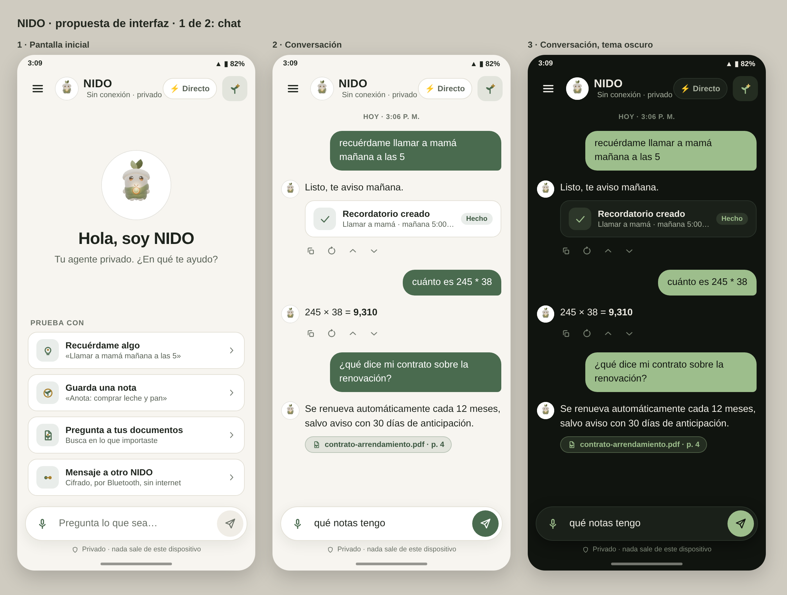

> **Language:** English · [Español](README.es.md)

<p align="center">
  
</p>

<h1 align="center">NIDO</h1>

<p align="center"><b>Your agent, your world.</b><br>
A private AI assistant that runs entirely on your Android phone.</p>

<p align="center">
  <a href="https://github.com/Nido007-cmyk/Nido/releases"></a>
  <a href="https://github.com/Nido007-cmyk/Nido/actions/workflows/ci.yml"></a>
  <a href="LICENSE"></a>
  
</p>

<p align="center">
  
</p>
<p align="center"><sub>Design mockups of the chat in v0.1.1-alpha. The shipped screens can differ in details.</sub></p>

## What NIDO is

NIDO is a personal assistant that thinks on your phone, not on someone else's
server. The language model, your memory and your documents all stay on the
device, encrypted. There are no accounts, no cloud and no analytics.

> **Alpha software.** NIDO is an early alpha for testing and feedback. It has
> not had an independent security audit. Do not rely on it for high-stakes
> secrets yet. See [known limitations](docs/ALPHA_RELEASE_NOTES.md#known-limitations).

## What it does today

- **Chats offline** with a small language model that runs on the phone
  (llama.cpp through `llama.rn`).
- **Remembers for you**: facts, notes and reminders, stored in a database
  encrypted with SQLCipher. The key lives in the Android Keystore.
  Birthdays you tell it get a reminder every year. An 8:00 daily summary is
  available if you turn it on (it's off by default). You can ask in Spanish,
  English or Portuguese about something you saved in another of the three,
  and "forget my favorite color" deletes that one memory after you confirm.
- **Acts on your requests**: reminders (once, or every day, week, month or
  year), countdowns, notes, calendar events, unit conversions, arithmetic,
  opening links. Anything with an effect outside the app asks for your
  confirmation first. Text you paste or share from another app is never
  taken as a command, and when a message holds more than one request, NIDO
  shows the command as a button and waits for your tap.
- **Answers from your documents**: import `.txt`, `.md`, `.csv`, `.json` or
  `.pdf` files, and images and scanned PDFs too, whose text NIDO reads on
  the phone itself in Spanish, English or Portuguese, and NIDO indexes them
  on the phone.
- **Knows things offline**: a built-in knowledge base plus an optional
  Wikipedia pack (about 50,000 articles) and nine optional guide packs
  written by NIDO (Essentials, Emergencies by country, Children and
  babies, Crisis and mental health, Living without utilities, Safe
  home, Disasters, Field and animals, Road and travel), with checked
  emergency numbers for 69 countries. With multilingual search on, you
  can ask in Spanish, Portuguese or English, and answers show the articles
  they come from, with a line that counts which sentences come from them and
  which come from the model with no source; when nothing in the base really
  matches, no source is shown.
- **Adds signed packs from a file** (0.1.80): Settings → Knowledge base →
  "Add a pack from a file" adds a knowledge pack you have as a file, for
  example one published by SALVORA PACKS. Before anything is copied, the
  app verifies its Ed25519 signature against the keys built into the app
  (NIDO's and SALVORA PACKS' only, no third-party keys), checks the file's
  fingerprint against its signed manifest, and refuses any pack that
  fails. An added pack is labelled with who signed it and can be removed
  from the same screen.
- **Reads the guides as documents** (0.1.81): the guide library opens
  any guide of the packs installed on the device and shows it whole,
  from start to finish, as a document. Reading does not load the
  language model, so it works even on a phone with no model downloaded
  yet, and it never uses the network. A very long guide is shown
  shortened, with a note saying so; the guide stays stored in full in
  its pack.
- **Loads its models again on devices with little RAM** (0.1.82): the
  check that runs before a model loads was charging every model about
  0.29 GB for output scores the engine only produces for one
  position, so on a tablet with about 3.3 GB of RAM no model could
  pass the check, however much memory was freed. The charge is
  corrected; the check still refuses when memory is really short, for
  example with other apps open.
- **Lighter on memory: models load one at a time and only when
  needed** (0.1.83): the chat model and the search model used to
  start together, each checking the same free memory as if it were
  alone; they now start one after the other, and a refused load is
  recorded with the numbers the check saw. Opening the app loads
  only the search model, so the guides and search work straight
  away; the chat model loads the first time you send a message and
  unloads after three minutes without chat. On small devices the
  models also start with a smaller batch (and the Qwen3 model with
  a smaller context), a low battery, power saving or a hot device
  lowers the thread count, and when Android reports critical memory
  pressure the models unload instead of waiting to be closed.
- **The memory check charges what the load really costs, and
  refusals can be read in the app** (0.1.84): switching models no
  longer counts the outgoing model's memory as still used on the
  side of the check that decides; the context cache and the
  compute buffer are charged at the precision and batch size the
  load will actually use; and on devices with 4 GB of memory or
  less the check tries one short-answer context below the usual
  floor before refusing. The Execution Telemetry screen now lists
  every refused load with the numbers the check saw, and the
  records travel in its JSON and CSV exports.
- **The emergency step of the memory check uses the memory
  that is really free, and an orderly unload no longer counts
  as a crash** (0.1.85): on devices with 4 GB of memory or
  less, the short-answer context of last resort is priced
  against the free memory Android reports at that moment,
  without the watermark and margin the normal steps subtract;
  unloading a model in good order (idle timeout, system
  pressure, switching models) no longer degrades the crash
  guard as if the app had crashed; and a refusal judged
  without the live memory reading now says so in its telemetry
  record. Every normal step keeps the stricter count, and the
  2 GB system headroom is unchanged.
- **Guides from a verified imported pack are answered as
  written, and the model badge is the verdict of the real
  load** (0.1.86): a pack that came in through the signed
  import door and verified is now served word for word from
  the chat, without loading the language model, under the
  same rule as the built-in packs, so asking about one of its
  guides no longer sends the question to the model with
  memory at its tightest; the compatibility badge of each
  model is judged with the same specification and planner
  verdict as the load itself (on a tablet like the owner's
  the 1.5B model now shows red, because even its cheapest
  emergency plan does not fit there); importing a pack asks
  for its signed manifest with a second picker instead of
  refusing when the first selection missed it; and the guide
  library can be opened from Settings in normal use. A
  suspected double counting in the crash guard was tested
  with a regression and does not exist; the guard is
  unchanged.
- **The health and emergency gate decides by meaning**
  (0.1.93): a question with no sources that the gate
  does not recognise as health or emergency is answered
  by the model from memory, and the gate was a word
  list. On 45 health and emergency questions it had
  never seen, the list recognised 4. A small classifier
  on the question's search vector now adds to it: with
  the multilingual search model the two together
  recognise 40 of 45, with the default English one 26 of
  45, and neither closed any of 50 everyday questions.
  A message about wanting to die or to hurt oneself
  always gets a fixed text with support lines, never a
  model. Read-aloud no longer reads a model's reasoning,
  and a renamed pack can no longer take the place of a
  catalog pack.
- **Sums get worked out, and a cut answer always says
  so** (0.1.92): on Qwen3-0.6B, a question that is a
  calculation (two or more figures and a «how many» or
  «what time») now lets the model reason before it
  answers, on that turn only; measured with the real
  model file and the app's own prompt, correct answers
  went from 16 of 60 to 41 of 60, and if the reasoning
  leaves no answer the turn is answered directly as
  before. The «answer was cut» fact is now read from the
  engine's own stop signal instead of counting streamed
  pieces, which undercounted and could leave an answer
  stopped by the limit without its note. A model marked
  «too heavy» that still has a partly downloaded file
  says so and offers to delete it, and one model whose
  check fails no longer blanks the state of the others.
- **Downloads settle, heavy models stop offering, and
  the last line reads whole** (0.1.91): a download
  retried after a failure now settles with that one
  download: the card offers «Select and use», because
  the presence check retries its file hash once when
  the calculation itself stumbles (a real mismatch is
  never retried into trust) and the card says why when
  a finished download cannot show as installed; a
  model marked «too heavy for this device» no longer
  offers a download or retry button, since that red
  mark is the load check's own verdict; and the guide
  reader, the guide library, CPR practice and the
  emergency country sheet now keep their bottom edge
  inside the safe area, so the last line of a long
  guide is no longer cut in half by the system bar;
  and the «ran low on space» note under a model's
  answer now appears only when a generation really
  used up its whole token budget, not whenever the
  turn was merely assigned less than the default.
- **The model answers again, and its answers finish**
  (0.1.90): a question no guide covers is generated by the
  loaded model instead of refused (the refusal now guards
  only health and emergency questions without evidence);
  the context budget shrinks its generation reserve before
  giving up, so a short story no longer dies with a
  technical error on a small context window; and the
  default answer length doubles, so a five step
  explanation or a short email comes out whole instead of
  closing early.
- **A smell of gas gets the gas guide, and two screens stop
  stepping on themselves** (0.1.89): the last release made
  the word for word road run, and on the owner's tablet it
  served a guide word for word for the gas question, with
  the pack's name on it and no model in between, but it was
  the carbon monoxide neighbour instead of the gas leak
  guide: measured against the owner's real pack, the pack's
  own keyword ranking puts the carbon monoxide fragment
  first on a coverage tie, and that guide's own text says
  its gas cannot be smelled. The choice now reads the sign
  in the question: when a question says you can smell, see
  or hear something, a guide that states its danger cannot
  be smelled, seen or heard loses the tie to a guide that
  does not say that, in Spanish, English and Portuguese,
  and when the first short list holds only the wrong
  neighbour the app checks the wider list before serving
  anything. The guide reader's header now sits below the
  system status bar, clear of the clock and the battery
  icons. And the NIDO screen's tabs size themselves to
  their labels, so the long tab word stays on one line; on
  a narrow phone the row scrolls instead of wrapping.
- **Talks to another NIDO over Bluetooth**: encrypted messages between two
  paired phones, with no internet and no server. To pair, you paste the
  other phone's code (the text of its QR); a contact shows as verified only
  after you both compare fingerprints, in person or on a call, and tap
  Verify. New and experimental since 0.1.76: when a contact is out of
  range, a message can reach them through another contact you both have,
  in a sealed envelope the carrier can't read or change; carrying other
  people's messages is off unless you turn it on
  ([how it works](docs/RELAY.md)).
- **Has an Emergency tab**: your country's emergency numbers, checked
  against official sources (69 countries in the NIDO Local pack), each with
  its source and date. "Call" opens the dialer with the number typed in.
  Quick guides (CPR, bleeding, choking, burns, earthquake, hurricane) and
  "describe what's happening" write the question into the chat. First aid
  questions are answered with the NIDO Essentials guide exactly as written,
  with no AI model in between, even when you ask for a short version (you
  get the start of the guide as written). Describing carbon monoxide
  symptoms near a heater, generator or stove gets a fixed warning to get
  outside and call for help. When a
  newer version of the pack exists, the one you have keeps working offline
  and the app says an update is available. "Practise CPR" (0.1.76) is a
  training tool for a cushion or a manikin, never for a person: a beep at
  110 per minute, 30:2 with the guide read aloud, and an optional camera
  meter for your rate ([why practice only](docs/CPR_PRACTICE.md)).
- **Five sections one tap away**: Chat, Emergency, Library, NIDO and
  Settings, in a bottom bar. Settings is grouped and has a search box.
- **Shows its network use**: every download the app makes, and every local
  Wi-Fi connection to another NIDO, is logged and visible in Settings ›
  Security and privacy; the log is kept across restarts.
- **Measures itself, on the phone**: the Execution Telemetry screen (Settings › Diagnostics) shows generation
  speed, time to first word, how long request routing takes and how many
  commands the router missed and sent to the model, recorded locally and
  never sent anywhere. Optionally (off by default) it can keep the missed
  phrases on the phone so you can review them.

- **Lets you report an answer**: after a thumbs-down, "Report" opens your
  email app with a draft (the question, the answer and the app version).
  You read it, delete anything you want, and send it yourself. NIDO sends
  nothing.

The interface is available in English, Spanish and Portuguese.

## Install

1. Download `app-release.apk` from the
   [v0.1.93-alpha release](https://github.com/Nido007-cmyk/Nido/releases/tag/v0.1.93-alpha).
2. Check it against the `app-release.apk.sha256` file published next to it.
3. Install it on an Android phone (arm64).
4. On first launch NIDO downloads its language model, between about 0.4
   and 1.1 GB depending on your phone's memory and language. This is the
   only time it needs the internet.

## Privacy and security

- Data at rest is encrypted with SQLCipher; the key is held by the Android
  Keystore and Android cloud backup is disabled.
- If the key cannot be read, NIDO stops instead of opening data unencrypted.
- Content that comes from outside (a contact's message, a file, a note) is
  treated as data, never as instructions, and actions that write or send
  something after reading it ask for confirmation.
- Optional hardware vault: the database key can be tied to your fingerprint
  or PIN in the phone's secure hardware, with a strict mode that closes NIDO
  after a short time in the background.
- Messages between two NIDOs (Bluetooth, or local Wi-Fi as a backup route)
  are end-to-end encrypted with keys exchanged by QR code (X25519 key
  agreement, Ed25519 signatures, XSalsa20-Poly1305). Since 0.1.49, on by
  default between two NIDOs that support them: the first messages are
  sealed so nobody nearby can see who is calling ("Private hello"), every
  message gets its own key (Double Ratchet, as in Signal) and each
  connection adds ML-KEM-768 against future quantum computers. With an older
  NIDO on the other side, the connection falls back to what that phone
  supports. Messages are padded to fixed sizes. The handshake is checked
  with formal verification (`formal/`).
- Disappearing messages in NIDO-to-NIDO chats, an optional panic button that
  erases everything in 3 seconds, and an incognito keyboard (the keyboard is
  asked not to learn from what you type).
- Screenshots are blocked, other apps' overlays are hidden while NIDO is on
  screen (Android 12+), and erasing all data asks for your fingerprint or PIN.

[Privacy policy](PRIVACY.md) · [terms of use](TERMS.md). More detail: [privacy hardening](docs/PRIVACY.md) · [crypto architecture](docs/CRYPTO_ARCHITECTURE.md) ·
[threat model](docs/THREAT_MODEL_SUMMARY.md) · [audit reports](docs/security/README.md) · [reporting a vulnerability](SECURITY.md)

## Status

Alpha, November 2026. The project has more than 6,000 automated tests and
runs type checking and the test suite on every change. What automated tests
cannot cover is behaviour on real hardware, so the headline flows are also
exercised on physical Galaxy tablets: chat and agent tools, memory,
reminders and notifications, backup and recovery, and two-device P2P
messaging, including in airplane mode. Bluetooth still varies by phone
model.

Known limitations of the current release, including what a backup can and
cannot restore, are listed in the
[release notes](docs/ALPHA_RELEASE_NOTES.md). Changes per version are in the
[changelog](CHANGELOG.md).

## Build from source

NIDO does not run in Expo Go: it uses native modules. You need the Android
SDK, NDK and a JDK, or an EAS build.

```bash
npm install
npx expo prebuild -p android --clean
npx expo run:android --device
```

Checks that do not need a device:

```bash
npm run typecheck
npm test
```

The full build guide, including release APKs and signing, is in
[AGENTS.md](AGENTS.md).

## Project layout

```
src/
  agent/      Agent: memory, tools, loop, safety policy
  p2p/        NIDO-to-NIDO messaging over Bluetooth
  privacy/    Key management and network log
  security/   Encrypted database, backup, biometric gate
  inference/  On-device language model engine
  rag/        Document indexing and retrieval
  models/     Model catalog and verified downloads
  ui/         Screens and components
  i18n/       English, Spanish and Portuguese texts
modules/      Native Android modules
docs/         Documentation (see docs/README.md)
```

## Contributing

Bug reports and feedback from testers are the most useful contribution right
now. Please use the issue templates. Phrases NIDO misunderstood have their own
template: [Phrases NIDO missed](https://github.com/Nido007-cmyk/Nido/issues/new?template=router_miss.yml).
NIDO never sends those phrases by itself: you review and copy the optional
on-device list, remove anything personal, and paste only what you choose to
share. You can also email the list yourself, from your own mail app, to
arsrs91@gmail.com. For code, read [CONTRIBUTING.md](CONTRIBUTING.md) and the
[code of conduct](CODE_OF_CONDUCT.md) first.

## Credits and license

NIDO is released under the [MIT License](LICENSE).

It started as a fork of [BOAR](https://github.com/rferrari/boar-app) by the
aoair contributors, also MIT. BOAR's offline inference and retrieval
foundation is reused; the agent, the encrypted storage, the safety policy
and the Bluetooth protocol are NIDO's own work.
[ATTRIBUTION.md](ATTRIBUTION.md) lists what came from where.

AI models and knowledge packs are downloaded separately and keep their own
licenses (Apache-2.0, MIT, the LFM Open License v1.0 for LFM2.5, and
CC BY-SA 4.0 for Wikipedia text, some of which ships inside the app). The
open-source packages compiled into the app are listed with their license
texts in [THIRD_PARTY_NOTICES.md](THIRD_PARTY_NOTICES.md). All of it is also
readable inside the app, in About → Licenses.
