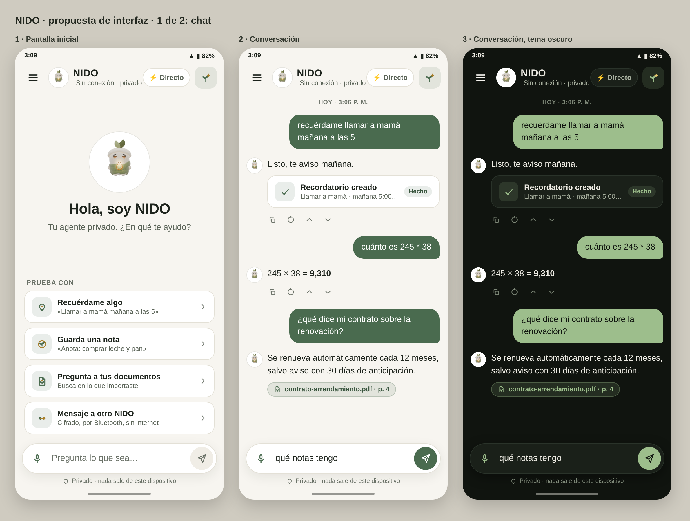

> **Language:** English · [Español](README.es.md)

<p align="center">
  
</p>

<h1 align="center">NIDO</h1>

<p align="center"><b>Your agent, your world.</b><br>
A private AI assistant that runs entirely on your Android phone.</p>

<p align="center">
  <a href="https://github.com/Nido007-cmyk/Nido/releases"></a>
  <a href="https://github.com/Nido007-cmyk/Nido/actions/workflows/ci.yml"></a>
  <a href="LICENSE"></a>
  
</p>

<p align="center">
  
</p>
<p align="center"><sub>Design mockups of the chat in v0.1.1-alpha. The shipped screens can differ in details.</sub></p>

## What NIDO is

NIDO is a personal assistant that thinks on your phone, not on someone else's
server. The language model, your memory and your documents all stay on the
device, encrypted. There are no accounts, no cloud and no analytics.

> **Alpha software.** NIDO is an early alpha for testing and feedback. It has
> not had an independent security audit. Do not rely on it for high-stakes
> secrets yet. See [known limitations](docs/ALPHA_RELEASE_NOTES.md#known-limitations).

## What it does today

- **Chats offline** with a small language model that runs on the phone
  (llama.cpp through `llama.rn`).
- **Remembers for you**: facts, notes and reminders, stored in a database
  encrypted with SQLCipher. The key lives in the Android Keystore.
  Birthdays you tell it get a reminder every year. An 8:00 daily summary is
  available if you turn it on (it's off by default).
- **Acts on your requests**: reminders (once, or every day, week, month or
  year), countdowns, notes, calendar events, unit conversions, arithmetic,
  opening links. Anything with an effect outside the app asks for your
  confirmation first. Text you paste or share from another app is never
  taken as a command, and when a message holds more than one request, NIDO
  shows the command as a button and waits for your tap.
- **Answers from your documents**: import `.txt`, `.md`, `.csv`, `.json` or
  `.pdf` files, and now images and scanned PDFs too, whose text NIDO
  reads on the phone itself, and NIDO indexes them on the phone.
- **Knows things offline**: a built-in knowledge base plus an optional
  Wikipedia pack (about 50,000 articles) and nine optional guide packs
  written by NIDO (Essentials, Local, Children and Babies, Crisis,
  Without Utilities, Safe Home, Disasters, Field and Animals, Road
  Travel), with checked emergency numbers for 69 countries. With multilingual search on, you
  can ask in Spanish, Portuguese or English, and answers show the articles
  they come from, with a line that counts which sentences come from them and
  which come from the model with no source; when nothing in the base really
  matches, no source is shown.
- **Talks to another NIDO over Bluetooth**: encrypted messages between two
  paired phones, with no internet and no server. To pair, you paste the
  other phone's code (the text of its QR); a contact shows as verified only
  after you both compare fingerprints, in person or on a call, and tap
  Verify.
- **Has an Emergency tab**: your country's emergency numbers, checked
  against official sources (69 countries in the NIDO Local pack), each with
  its source and date. "Call" opens the dialer with the number typed in.
  Quick guides (CPR, bleeding, choking, burns, earthquake, hurricane) and
  "describe what's happening" write the question into the chat. First aid
  questions are answered with the NIDO Essentials guide exactly as written,
  with no AI model in between, even when you ask for a short version (you
  get the start of the guide as written). Describing carbon monoxide
  symptoms near a heater, generator or stove gets a fixed warning to get
  outside and call for help. When a
  newer version of the pack exists, the one you have keeps working offline
  and the app says an update is available.
- **Five sections one tap away**: Chat, Emergency, Library, NIDO and
  Settings, in a bottom bar. Settings is grouped and has a search box.
- **Shows its network use**: every download the app makes, and every local
  Wi-Fi connection to another NIDO, is logged and visible in Settings ›
  Security and privacy; the log is kept across restarts.
- **Measures itself, on the phone**: the Execution Telemetry screen (Settings › Diagnostics) shows generation
  speed, time to first word, how long request routing takes and how many
  commands the router missed and sent to the model, recorded locally and
  never sent anywhere. Optionally (off by default) it can keep the missed
  phrases on the phone so you can review them.

The interface is available in English, Spanish and Portuguese.

## Install

1. Download `app-release.apk` from the
   [latest release](https://github.com/Nido007-cmyk/Nido/releases).
2. Check it against the `app-release.apk.sha256` file published next to it.
3. Install it on an Android phone (arm64).
4. On first launch NIDO downloads its language model, between 0.5 and 1 GB
   depending on your phone's memory. This is the only time it needs the
   internet.

## Privacy and security

- Data at rest is encrypted with SQLCipher; the key is held by the Android
  Keystore and Android cloud backup is disabled.
- If the key cannot be read, NIDO stops instead of opening data unencrypted.
- Content that comes from outside (a contact's message, a file, a note) is
  treated as data, never as instructions, and actions that write or send
  something after reading it ask for confirmation.
- Optional hardware vault: the database key can be tied to your fingerprint
  or PIN in the phone's secure hardware, with a strict mode that closes NIDO
  after a short time in the background.
- Messages between two NIDOs (Bluetooth, or local Wi-Fi as a backup route)
  are end-to-end encrypted with keys exchanged by QR code (X25519 key
  agreement, Ed25519 signatures, XSalsa20-Poly1305). Since 0.1.49, on by
  default between two NIDOs that support them: the first messages are
  sealed so nobody nearby can see who is calling ("Private hello"), every
  message gets its own key (Double Ratchet, as in Signal) and each
  connection adds ML-KEM-768 against future quantum computers. With an older
  NIDO on the other side, the connection falls back to what that phone
  supports. Messages are padded to fixed sizes. The handshake is checked
  with formal verification (`formal/`).
- Disappearing messages in NIDO-to-NIDO chats, an optional panic button that
  erases everything in 3 seconds, and an incognito keyboard (the keyboard is
  asked not to learn from what you type).
- Screenshots are blocked, other apps' overlays are hidden while NIDO is on
  screen (Android 12+), and erasing all data asks for your fingerprint or PIN.

[Privacy policy](PRIVACY.md) · [terms of use](TERMS.md). More detail: [privacy hardening](docs/PRIVACY.md) · [crypto architecture](docs/CRYPTO_ARCHITECTURE.md) ·
[threat model](docs/THREAT_MODEL_SUMMARY.md) · [reporting a vulnerability](SECURITY.md)

## Status

Alpha, October 2026. The project has more than 4,500 automated tests and
runs type checking and the test suite on every change. What automated tests
cannot cover is behaviour on real hardware, so the headline flows are also
exercised on physical Galaxy tablets: chat and agent tools, memory,
reminders and notifications, backup and recovery, and two-device P2P
messaging, including in airplane mode. Bluetooth still varies by phone
model.

Known limitations of the current release, including what a backup can and
cannot restore, are listed in the
[release notes](docs/ALPHA_RELEASE_NOTES.md). Changes per version are in the
[changelog](CHANGELOG.md).

## Build from source

NIDO does not run in Expo Go: it uses native modules. You need the Android
SDK, NDK and a JDK, or an EAS build.

```bash
npm install
npx expo prebuild -p android --clean
npx expo run:android --device
```

Checks that do not need a device:

```bash
npm run typecheck
npm test
```

The full build guide, including release APKs and signing, is in
[AGENTS.md](AGENTS.md).

## Project layout

```
src/
  agent/      Agent: memory, tools, loop, safety policy
  p2p/        NIDO-to-NIDO messaging over Bluetooth
  privacy/    Key management and network log
  security/   Encrypted database, backup, biometric gate
  inference/  On-device language model engine
  rag/        Document indexing and retrieval
  models/     Model catalog and verified downloads
  ui/         Screens and components
  i18n/       English, Spanish and Portuguese texts
modules/      Native Android modules
docs/         Documentation (see docs/README.md)
```

## Contributing

Bug reports and feedback from testers are the most useful contribution right
now. Please use the issue templates. Phrases NIDO misunderstood have their own
template: [Phrases NIDO missed](https://github.com/Nido007-cmyk/Nido/issues/new?template=router_miss.yml).
NIDO never sends those phrases by itself: you review and copy the optional
on-device list, remove anything personal, and paste only what you choose to
share. You can also email the list yourself, from your own mail app, to
arsrs91@gmail.com. For code, read [CONTRIBUTING.md](CONTRIBUTING.md) and the
[code of conduct](CODE_OF_CONDUCT.md) first.

## Credits and license

NIDO is released under the [MIT License](LICENSE).

It started as a fork of [BOAR](https://github.com/rferrari/boar-app) by the
aoair contributors, also MIT. BOAR's offline inference and retrieval
foundation is reused; the agent, the encrypted storage, the safety policy
and the Bluetooth protocol are NIDO's own work.
[ATTRIBUTION.md](ATTRIBUTION.md) lists what came from where.

AI models and knowledge packs are downloaded separately and keep their own
licenses (Apache-2.0, MIT, the LFM Open License v1.0 for LFM2.5, and
CC BY-SA 4.0 for Wikipedia text, some of which ships inside the app). The
open-source packages compiled into the app are listed with their license
texts in [THIRD_PARTY_NOTICES.md](THIRD_PARTY_NOTICES.md). All of it is also
readable inside the app, in About → Licenses.
